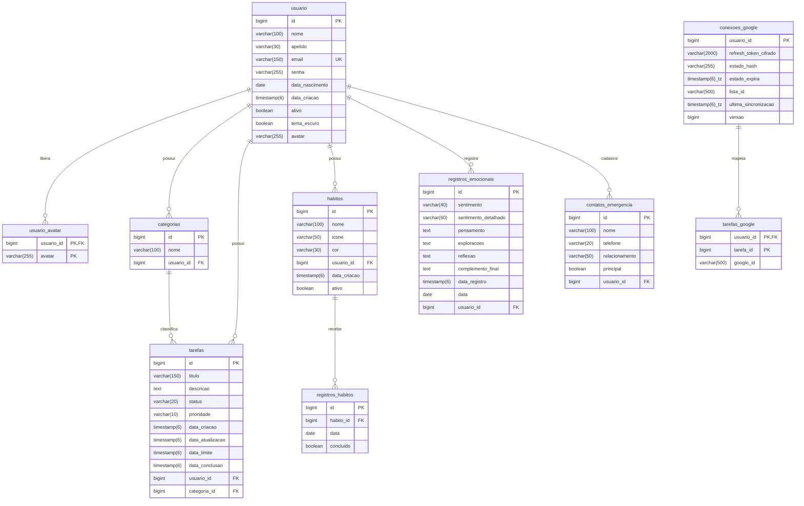

# Modelagem do banco de dados - Mindly

## Base da modelagem

Este documento descreve o esquema PostgreSQL definido pelas migrações `V1__schema_inicial.sql` e `V2__versao_google_e_indices.sql`, em `tcc_backend/src/main/resources/db/migration/`, confrontado com as entidades de `tcc_backend/src/main/java/com/example/tcc_backend/domain/` e com o serviço de gamificação. São 10 tabelas físicas, incluindo duas tabelas de coleções JPA.

A análise foi feita sobre os arquivos do projeto, sem consulta à instância do banco. Portanto, representa o esquema versionado e não comprova que todas as migrações estejam aplicadas no ambiente em execução.

## Modelo conceitual

O usuário é a entidade central. Cada usuário pode possuir categorias, tarefas, hábitos, registros emocionais e contatos de emergência. Cada tarefa pertence obrigatoriamente a uma categoria e a um usuário. Cada hábito pode receber vários registros de realização, com no máximo um registro por data. O diário admite no máximo um registro emocional por usuário e data.

A biblioteca de avatares liberados é uma coleção de valores vinculada ao usuário. A integração com Google Tasks armazena os dados da conexão e um mapa entre identificadores de tarefas locais e externas. Essas estruturas complementam o modelo principal.

## Diagrama entidade-relacionamento físico

As linhas representam apenas chaves estrangeiras declaradas nas migrações. `||` indica exatamente um e `o{` indica zero ou muitos. PK = chave primária; FK = chave estrangeira; UK = unicidade de uma coluna. As unicidades compostas estão detalhadas após o dicionário.

## Dicionário de dados

Os campos marcados como obrigatórios não aceitam `NULL`. Todas as colunas `id` são `BIGINT` com geração `GENERATED BY DEFAULT AS IDENTITY`. As outras chaves não possuem geração automática no SQL.

### `usuario`

| Campo | Tipo PostgreSQL | Obrigatório | Chave / restrição |
| --- | --- | --- | --- |
| `id` | `BIGINT` | Sim | PK |
| `nome` | `VARCHAR(100)` | Sim | - |
| `apelido` | `VARCHAR(30)` | Sim | - |
| `email` | `VARCHAR(150)` | Sim | UNIQUE |
| `senha` | `VARCHAR(255)` | Sim | - |
| `data_nascimento` | `DATE` | Sim | - |
| `data_criacao` | `TIMESTAMP(6)` | Sim | - |
| `ativo` | `BOOLEAN` | Sim | - |
| `tema_escuro` | `BOOLEAN` | Não | - |
| `avatar` | `VARCHAR(255)` | Não | - |

### `usuario_avatar`

| Campo | Tipo PostgreSQL | Obrigatório | Chave / restrição |
| --- | --- | --- | --- |
| `usuario_id` | `BIGINT` | Sim | PK composta; FK -> usuario(id) |
| `avatar` | `VARCHAR(255)` | Sim | PK composta |

### `categorias`

| Campo | Tipo PostgreSQL | Obrigatório | Chave / restrição |
| --- | --- | --- | --- |
| `id` | `BIGINT` | Sim | PK |
| `nome` | `VARCHAR(100)` | Sim | - |
| `usuario_id` | `BIGINT` | Sim | FK -> usuario(id) |

### `tarefas`

| Campo | Tipo PostgreSQL | Obrigatório | Chave / restrição |
| --- | --- | --- | --- |
| `id` | `BIGINT` | Sim | PK |
| `titulo` | `VARCHAR(150)` | Sim | - |
| `descricao` | `TEXT` | Não | - |
| `status` | `VARCHAR(20)` | Sim | - |
| `prioridade` | `VARCHAR(10)` | Sim | - |
| `data_criacao` | `TIMESTAMP(6)` | Sim | - |
| `data_atualizacao` | `TIMESTAMP(6)` | Sim | - |
| `data_limite` | `TIMESTAMP(6)` | Não | - |
| `data_conclusao` | `TIMESTAMP(6)` | Não | - |
| `usuario_id` | `BIGINT` | Sim | FK -> usuario(id) |
| `categoria_id` | `BIGINT` | Sim | FK -> categorias(id) |

### `habitos`

| Campo | Tipo PostgreSQL | Obrigatório | Chave / restrição |
| --- | --- | --- | --- |
| `id` | `BIGINT` | Sim | PK |
| `nome` | `VARCHAR(100)` | Sim | - |
| `icone` | `VARCHAR(50)` | Sim | - |
| `cor` | `VARCHAR(30)` | Sim | - |
| `usuario_id` | `BIGINT` | Sim | FK -> usuario(id) |
| `data_criacao` | `TIMESTAMP(6)` | Sim | - |
| `ativo` | `BOOLEAN` | Sim | - |

### `registros_habitos`

| Campo | Tipo PostgreSQL | Obrigatório | Chave / restrição |
| --- | --- | --- | --- |
| `id` | `BIGINT` | Sim | PK |
| `habito_id` | `BIGINT` | Sim | FK -> habitos(id) |
| `data` | `DATE` | Sim | - |
| `concluido` | `BOOLEAN` | Sim | - |

### `registros_emocionais`

| Campo | Tipo PostgreSQL | Obrigatório | Chave / restrição |
| --- | --- | --- | --- |
| `id` | `BIGINT` | Sim | PK |
| `sentimento` | `VARCHAR(40)` | Sim | - |
| `sentimento_detalhado` | `VARCHAR(60)` | Não | - |
| `pensamento` | `TEXT` | Não | - |
| `exploracoes` | `TEXT` | Não | - |
| `reflexao` | `TEXT` | Não | - |
| `complemento_final` | `TEXT` | Não | - |
| `data_registro` | `TIMESTAMP(6)` | Sim | - |
| `data` | `DATE` | Sim | - |
| `usuario_id` | `BIGINT` | Sim | FK -> usuario(id) |

### `contatos_emergencia`

| Campo | Tipo PostgreSQL | Obrigatório | Chave / restrição |
| --- | --- | --- | --- |
| `id` | `BIGINT` | Sim | PK |
| `nome` | `VARCHAR(100)` | Sim | - |
| `telefone` | `VARCHAR(20)` | Sim | - |
| `relacionamento` | `VARCHAR(50)` | Não | - |
| `principal` | `BOOLEAN` | Sim | - |
| `usuario_id` | `BIGINT` | Sim | FK -> usuario(id) |

### `conexoes_google`

| Campo | Tipo PostgreSQL | Obrigatório | Chave / restrição |
| --- | --- | --- | --- |
| `usuario_id` | `BIGINT` | Sim | PK |
| `refresh_token_cifrado` | `VARCHAR(2000)` | Não | - |
| `estado_hash` | `VARCHAR(255)` | Não | - |
| `estado_expira` | `TIMESTAMP(6) WITH TIME ZONE` | Não | - |
| `lista_id` | `VARCHAR(500)` | Não | - |
| `ultima_sincronizacao` | `TIMESTAMP(6) WITH TIME ZONE` | Não | - |
| `versao` | `BIGINT` | Sim | - |

### `tarefas_google`

| Campo | Tipo PostgreSQL | Obrigatório | Chave / restrição |
| --- | --- | --- | --- |
| `usuario_id` | `BIGINT` | Sim | PK composta; FK -> conexoes_google(usuario_id) |
| `tarefa_id` | `BIGINT` | Sim | PK composta |
| `google_id` | `VARCHAR(500)` | Não | - |

## Integridade e regras de domínio

- `usuario.email` é único no banco.
- `usuario_avatar` tem PK composta `(usuario_id, avatar)`, impedindo a repetição do mesmo avatar para um usuário. `usuario.avatar` guarda a seleção atual; a coleção guarda os avatares liberados.
- `registros_habitos` tem `UNIQUE (habito_id, data)`, nomeada `uk_registro_habito_data`.
- `registros_emocionais` tem `UNIQUE (usuario_id, data)`, nomeada `uk_registro_emocional_usuario_data`.
- `tarefas_google` tem PK composta `(usuario_id, tarefa_id)`.
- `tarefas.status` aceita `PENDENTE`, `EM_ANDAMENTO` ou `CONCLUIDA` por constraint `CHECK`.
- `tarefas.prioridade` aceita `BAIXA`, `MEDIA` ou `ALTA` por constraint `CHECK`.
- A categoria de uma tarefa é obrigatória tanto no SQL quanto na entidade `Tarefa`. A FK garante a existência da categoria; a correspondência entre o dono da tarefa e o dono da categoria depende da aplicação, pois não há uma FK composta que imponha essa condição.
- As FKs não declaram `ON DELETE CASCADE`; o comportamento padrão do PostgreSQL é `NO ACTION`. Exclusões de registros referenciados dependem da remoção ou desvinculação dos dependentes, respeitando as transações e regras da aplicação.
- `contatos_emergencia.principal` é obrigatório, mas não existe índice único parcial que limite a um contato principal por usuário no esquema analisado.
- `conexoes_google.versao` é usada por `@Version` para controle otimista de concorrência. A V2 preenche registros existentes com zero e torna a coluna obrigatória, sem definir `DEFAULT` permanente.

## Associações lógicas da integração Google

| Origem | Destino lógico | Cardinalidade pretendida | Garantia física |
| --- | --- | --- | --- |
| `conexoes_google.usuario_id` | `usuario.id` | Usuário 1 -> 0..1 conexão | A PK limita uma conexão por identificador, mas não há FK para `usuario` |
| `tarefas_google.tarefa_id` | `tarefas.id` | Tarefa local -> mapeamento externo no contexto da conexão | Não há FK para `tarefas`; a PK impede repetição do par usuário/tarefa |

Essas associações não aparecem como FKs no diagrama físico. `ConexaoGoogle` utiliza um identificador simples `usuarioId` e uma coleção `Map<Long, String>` para os mapeamentos. O esquema, isoladamente, permite identificadores de usuário ou de tarefa sem correspondência nessas duas associações lógicas.

## índices explícitos

| índice | Tabela | Colunas |
| --- | --- | --- |
| `idx_registro_emocional_usuario_data` | `registros_emocionais` | `usuario_id, data` |
| `idx_categorias_usuario` | `categorias` | `usuario_id` |
| `idx_tarefas_usuario` | `tarefas` | `usuario_id` |
| `idx_tarefas_categoria` | `tarefas` | `categoria_id` |
| `idx_habitos_usuario` | `habitos` | `usuario_id` |
| `idx_contatos_usuario` | `contatos_emergencia` | `usuario_id` |

Além desses índices, PostgreSQL cria índices para as chaves primárias e restrições `UNIQUE`. O índice explícito de registros emocionais cobre as mesmas colunas da respectiva unicidade composta.

## Dados calculados e valores da aplicação

Não há tabelas específicas para conquistas, pontuação ou sequências no esquema analisado. `GamificacaoService` calcula indicadores e conquistas a partir de tarefas, hábitos e registros emocionais; os avatares liberados são persistidos em `usuario_avatar`.

Os avatares são persistidos como texto por enums JPA: `ARVORE`, `FLOR`, `ESTRELA`, `CORUJA`, `GATO`, `CORACAO`, `CEREBRO`, `SOL`, `BORBOLETA`, `COGUMELO`, `NUVEM`, `LUA` e `XICARA`. Não existe `CHECK` SQL para esse conjunto nas migrações analisadas. Também não há tabela de catálogo de sentimentos ou restrição `CHECK` para seus valores.

`senha` armazena o hash utilizado na autenticação. `refresh_token_cifrado` representa o token cifrado da integração. O documento descreve apenas a estrutura, sem reproduzir dados de usuários ou credenciais.

## Texto sugerido para o TCC

A persistência do Mindly foi estruturada em um banco relacional PostgreSQL, com esquema controlado por migrações Flyway. A modelagem contém dez tabelas e tem o usuário como entidade central, relacionado aos módulos de tarefas, categorias, hábitos, diário emocional e contatos de emergência. As chaves estrangeiras asseguram a integridade dos relacionamentos principais, enquanto restrições de unicidade impedem a duplicação de registros de hábitos e registros emocionais na mesma data, dentro de seus respectivos contextos. Tabelas auxiliares armazenam avatares liberados e os mapeamentos da integração com Google Tasks. Os indicadores de gamificação são calculados pela aplicação a partir dos registros persistidos. Na integração externa, parte das associações é lógica e não possui chave estrangeira declarada no esquema versionado.
